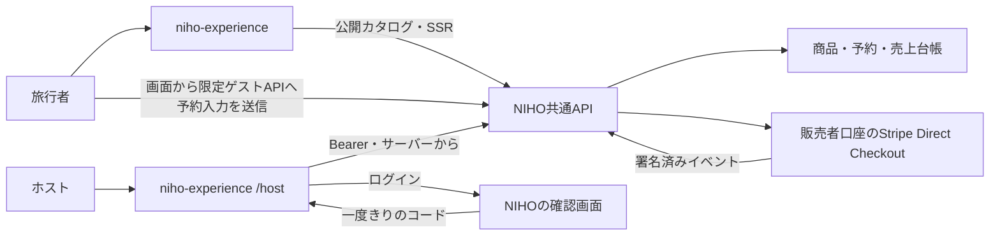

# 構成とデータ境界

> **現行方針（2026-11-04）**: niho-experienceが商品・公開版・開催枠・Experience予約・取引の正本を持つ。本人が商品を作り、公開・停止・再開する。新しいExperience販売に旧NIHO商品の移行や同一開催回の二重販売を持ち込まない。既存の旧NIHO予約照会・履行・取消／返金はNIHO側の責任に残す。現在のNIHO認証本人と同じ販売者のConnect口座だけをサーバー契約で参照する。コミュニティディナーは販売者・受取先ともPanasonicで、NIHOkamakuraはStripe表示名。Checkoutは有効なExperience公開版だけを対象にする。[ADR 0002](adr/0002-experience-domain-ownership.md) と [NIHO Host v1 consumer contract](host-niho-v1-consumer.md) を優先する。

決定日：2026-10-19。画面の独立開発と、NIHOアカウント・販売者口座・売上管理の共通利用を両立する。

2026-11-03 のオーナー決定で、提供者の登録審査・体験ごとの掲載承認・通常保存時の再審査は廃止する。必要条件を満たした OWNER が同意して公開・停止・再開し、運営による規約違反等の停止は独立して残す。目標仕様と現行 HTTP 版の移行境界は [ホスト自身による体験の公開](host-publication.md)（#369）を正とする。以下の NIHO の「掲載審査」は切替前の現状を説明する。

## 責務

| 担当 | 持つもの |
| --- | --- |
| niho-experience（公開） | トップ、検索、詳細、予約入力、公開本文のSSR、SEO、翻訳UI、APIクライアント、合成fixture、ホストの画面（`/host`：登録・体験ページ・予約対応・売上の画面、セッション、NIHOのAPIの中継）、Admin予約支援UI（`/admin`：独立セッションと選別されたAdmin APIの中継。仮契約は[Admin予約支援](admin-support.md)） |
| NIHO共通基盤 | ログイン、現在の本人ID、明示指定されたConnect口座のreadinessと再利用同意。ExperienceのOWNER権限は含まない |
| Experience | seller mappingとOWNER membership、商品・公開・予約・取引の権限と正本 |
| Stripe | 既存Connect Directによる決済、必要な販売者の本人確認・口座情報の収集 |

バックエンドのソースを公開できないから分けるのではなく、共通業務の正本を一か所に保つために分ける。個人情報の保護は、API認可、公開データの選別、実行環境、配備権限によって担保する。



## 旅行者と提供者

旅行者は英語のページで体験を探し、日時・人数・料金・販売者・キャンセル条件を確認する。会員登録を求めず、必要最小限の連絡先をゲストAPIへ送信し、StripeのCheckoutに移る。価格、在庫、販売者、決済口座は共通APIが決定する。v1の予約確認は既存NIHO側を使い、決済の成立はwebhookを正とする。

提供者（ホスト）は `/host` へNIHOでログインする。Experience serverが一度きりのコードをNIHO専用Web access tokenへ交換し、tokenはsealed server-side sessionだけに保持する。NIHO cookieは共有せず、ブラウザーへtokenを渡さない。現在のNIHO Host v1.0.0は本人IDとACTIVE状態、明示指定したlegacy Connect readだけを提供し、provider一覧・登録・更新・Connect変更やExperience商品APIは持たない。契約のsource SHA、認証headers、response schema、配備条件は[NIHO Host v1 consumer contract](host-niho-v1-consumer.md)を参照する。

Experienceの商品APIは各要求でNIHOの現在本人IDを取得し、運営登録済みのseller profileにあるNIHO account referenceと完全一致するExperienceの有効OWNER membershipだけを許可する。初回ログインは一致するprofileが一つあり競合membershipがない場合だけExperience OWNER membershipを結ぶ。NIHOが返さないroleを推測せず、`ownerUserId`や旧provider IDで本人を代用しない。Connectはprofileで固定したlegacy lookup keyで読み、返却Stripe account IDの完全一致・readiness・NIHO payment reuse consentを公開前に確認する。商品原稿・写真・販売条件・公開・Experience予約と返金はExperienceが所有し、旧NIHO予約の照会・履行・取消／返金はNIHOが保持する。

NIHO名義の一商品だけを担当する講師は、NIHO provider memberへ昇格させず、Experience内の[商品限定運営者](product-operators.md) grantでカレンダーだけを扱う。NIHOのfresh identityとhost API接続確認は省略せず、予約・売上・Google管理などprovider-wide情報は公開しない。

コンテンツの所有者、決済上の販売者、地域・掲載先は別の概念とする。外部の個人提供者にダミーの拠点や他拠点の管理権限を付与しない。

## 対面通訳（[#181](https://github.com/niho-life/niho-experience/issues/181)）

対面の日英通訳（公開 SDK [niho-translate](https://github.com/niho-life/niho-translate)）は NIHO の製品で、設計の正は niho-app の Epic [niho-coliving/niho-app#19446](https://github.com/niho-coliving/niho-app/issues/19446)。体験サイトが持つのは入口だけで、通訳そのものは持たない。

| 担当 | 持つもの |
| --- | --- |
| NIHO API（Authority） | 部屋、host / guest の participant と招待 code、relay の入室券（EdDSA JWT・60 秒）と JWKS、presence・control・lease、名義（体験提供者）ごとの予算と使用量 |
| relay（NIHO が運用） | iPhone と OpenAPI の音声の中継。OpenAI の鍵は relay だけが持つ |
| iPhone（NIHO アプリ・App Clip） | 招待 URL `https://niho.life/t#<code>`（stg は `app-stg.niho.life`）を開き、同意・イヤフォンの確認・開始・終了 |
| niho-experience | Experience Storeの予約を正本にしたホスト画面とBFF。Experience DB予約は `/host/api/translate/site/providers/{providerId}/bookings/{bookingId}/rooms[/{roomId}[/end]]`。旧NIHO予約の表示・通訳経路は撤去済み |

- 流れ：英語圏のゲストの確定予約（EN、または未記録）で、当日以降に「通訳を始める」を出す。Experience DB予約はBFFが現在のNIHO OWNERとExperience storeのOWNER+予約所属を毎回照合し、create時だけ確定・未取消・当日以降を確認して、NIHOの`site-bookings/{publicBookingId}/translate-rooms`へopaqueなUUIDだけを送る。status/endは取消・日付変更後も所属を再確認して自分のroomを終了できる。NIHO側の固定export contractに旧予約pathが残っていても、Experienceは呼び出さない。
- 境界：NIHO の access tokenはサーバーのsealed HttpOnly cookieに留まり、ブラウザは `/host/api/translate/*` だけを呼ぶ。旅行者の氏名・メール・状態・言語・role・budgetはNIHOへ送らない。BFF は `participantId`・`inviteCode` を落とし、招待 URL・状態・参加状況だけを `private, no-store` / `noindex` / `no-referrer` で返す。HTTP失敗をmockへ差し替えない。
- 契約：`packages/api-client/contract/experience-translate-rooms-api.openapi.json` v1.0.0（source契約は`agreed-not-deployed`）。NIHOのselected exportとsha256を同期し、source commitを`5ed6ebac62b5f14dd0d114d7893bc0099d9df776`へ固定。stg候補sourceと固定contract hashの一致は確認済みだが、runtime read-backと実予約create/poll/endは未受入。公開状態は`waiting | active | paused | ended`、endは`{roomId,state}`。受入までは`EXPERIENCE_TRANSLATE_API_ENABLED`をOFFに保つ。httpの通訳flagはホスト画面とDBを前提にguest sales flagから独立する。guest salesがOFFの場合もOWNERの予約一覧/詳細と通訳だけをread-onlyで開き、guest checkout・予約更新・取消/返金・メールを開かない。mockはExperience予約とstandalone pathだけを合成する。
- 保存しないもの：音声・字幕・ゲストの個人情報。体験サイトは部屋や使用量の記録も持たず、必要なら NIHO から読む。

## API契約

- 実行時はHTTPS APIで接続する。公開サイトからDBやprivateリポへ接続しない。
- 旅行者向けの公開APIは認証を使わない。ホストの画面のAPIは、サーバーからBearer（NIHO Web app-connect専用の短命access token）で呼ぶ。二つは契約・型・監査を分ける（[#87](https://github.com/niho-life/niho-experience/issues/87)）。
- Admin予約支援APIはホストAPIとも分け、NIHOが検証したAdmin tokenをexperienceのサーバーだけが持つ。通常のホストcookie・役割・クエリでAdminへ昇格させない。HTTPモードの選別済みAdmin認証、予約・通知read、予約別担当・内部メモcaseは別契約・別flagで受け入れ、いずれも配備・受入までは準備中として閉じる。caseを有効にしても承認・辞退・取消／返金・送信・権限付与へ広げない。
- Admin操作とホスト本人の支援履歴も独立した選別契約・既定OFF flag・固定BFFに分ける。操作は最新snapshotとUUID v4のimmutable command、同ID照合、APIのretryAllowedに従い、画面で料金や返金を再計算しない。ホスト履歴は本人scope内の最小metadataだけとし、内部メモ・Admin連絡先・hash・Stripe IDを渡さない。どちらもAPI先行配備・受入までは`agreed-not-deployed`として閉じ、HTTP失敗をmockへ差し替えない。
- 記事本文・画像・下書き・版・公開操作はEditorクラウド、writer権限と記事連携の招待・同意・取消はNIHO、カテゴリと現在の提供者OWNER・公開体験はExperienceが正本。writer grantのoutbox複製は使わない。カテゴリ管理の限定Admin APIは維持し、記事連携はNIHOの用途別APIと現在権限のサービス専用APIを使う。旧`/editor`の認証・書込は閉じる。詳細は[記事連携契約](editor-article-authority.md)を参照する。
- Host本人のNIHOサポート設定もAdminや予約履歴から分離した選別契約・固定BFFとする。通常Spotと外部Providerをkind/idで区別し、NIHO APIが毎回の現在OWNERを判定する。画面は設定・同意だけを保存し、料金producer・予約snapshot・精算への接続済みとは扱わない（[Host本人のNIHOサポート設定](host-support-settings.md)）。
- NIHO側の契約から、このサイトに必要なDTO・操作・参照型だけを選別して配布する。公開対象の検証と合成例を伴わせ、全内部スキーマを輸出しない。
- 初期の画面開発では仮契約と合成fixtureを用いる。連携担当が契約を確定して版を固定する。APIとmockは同じ契約検証を通す。
- カタログ取得、開催枠・料金、ゲストCheckout、エラー・期限切れ、予約確認への遷移を定義する。仮契約は [公開API契約](api-contract.md)。
- APIの互換拡張を先に配備する。公開SDKは固定版・SHAと整合性情報で参照し、可変mainや実行時の外部JS差し替えに依存しない。
- 個別商品をどの地域・公開サイトへ掲載できるかを共通APIで管理する。CORSは認可の代わりにせず、許可origin・path・method・戻り先を限定する。

## 公開・非公開

2026-10-22のオーナー決定により、ヘッダー・余白・レイアウト・スタイルはこのリポジトリのコードを正本とする。公開SSRは英日ともコードで描画し、ビジュアルエディタのPageDocumentやsource-displayによる上書きを行わない。新しい画面の追加・変更に、エディタへの追従、プレビュー一致、描画部品や画像の版同期は要求しない。

体験原稿・写真・商品・開催枠・販売条件・予約・決済はExperienceが所有し、`/host` から管理する。旅行者ページとCheckoutは現在有効なExperience公開版を読む。NIHOは共通ログイン、OWNER、同一販売者のConnect readinessを提供する。`noindex` とゲスト入力のデータ境界も維持する。

旧エディタのソースと保存データは将来用に保持する。再接続は別途設計・受入を行う。翻訳の現行境界は[日英の公開表示](localization-consumer.md)を参照。

| 情報 | 扱い |
| --- | --- |
| 掲載許諾済みの体験紹介・価格・提供者紹介・写真 | 公開APIからSSR/SEO/cacheへ。画像の公開範囲も明示する |
| 顧客情報、未公開原稿、非公開集合場所、本人確認、予約・売上 | 認可された共通APIと保管先。公開レスポンス・Git・fixture・ビルド・計測へ入れない |
| 予約入力・確認token | 本人向け処理に限定。no-store、検索対象外、ログ・分析への流出防止。noindexだけでは保護済みと扱わない |
| 本番鍵・DB資格情報 | Gitに保存しない。公開ビルド・外部PRへ渡さない |

公開停止後の予約停止、価格改ざん、販売者の取り違え、同時予約、二重送信、遅延・重複webhook、返金、他人の原稿・予約へのアクセスを連携側の受入対象にする。
フロントは安全な本文描画、画像・リンクの扱い、CSP、個人情報を含まないエラー記録を担当する。

## ディレクトリ案

```text
apps/web/                 # 公開サイト。SSR、一覧、詳細、予約入力
packages/experience-ui/    # 必要になった共通表示部品
packages/api-client/       # 選別された契約・型・クライアント・合成の体験/開催枠/提供者と mock（docs/api-contract.md）
fixtures/                 # API 以外の合成素材が必要になったとき
docs/                     # 公開可能な仕様・開発方法・運用
```

フレームワーク、ホスティング、正式ドメインは基盤Issueで比較・決定する。SSRの可否、公開データだけでのビルド、開発速度、運用費を判断材料にする。初日から汎用CMS・複数アプリ・共通デザインパッケージを完成させる必要はない。

## 段階と共通基盤への変更

1. モックで画面・契約・商品編集方針を固める。
2. 連携A：既存NIHO拠点の商品を使い、カタログからゲスト予約、決済、確認まで接続する。
3. 連携B：外部提供者がNIHOアカウントで登録し、権限のある販売者・口座を使って出品し、予約と売上を管理できるようにする。
4. 連携C：その画面をこのサイトの `/host` で作る（[#84](https://github.com/niho-life/niho-experience/issues/84)）。NIHOの旧い提供者画面は、`/host` の本番受入の後に転送する。

初期試験販売は既存拠点で始められる。**複数の外部提供者が登録できるv1の完成には連携Bも必要**。セルフ登録の開放を伴わない試験販売を、全機能完成と扱わない。
共通基盤のPRはA/Bの原則2本を目標にし、必要な仕様・移行・契約・検証を各PRへまとめる。危険な巨大差分になる場合は具体的な理由を示して分ける。必須検証を省略して本数だけを守らない。

Connect Directの口座設定・責任分担を今回変更しない。サイトの見た目・サポート窓口と販売者を混同せず、販売者の表示と契約条件を商品ごとに確認する。将来のP2P、ウォレット、資金移動は別の設計対象とする。

## 決める時期が後になる事項

- 公開ドメイン・表示名：本番公開前。既存NIHOの商品ページと正規URLを統一する。
- 販売条件・キャンセル基準・サポート分担：商品を有料で公開する前。
- 提供者本人が行う編集とNIHOによる代理編集の範囲：連携B・Cの仕様確定時。
- 再利用ライセンス：別途オーナー判断。リポのpublic設定と一般的なOSS許諾を同一視しない。

参考：[公開クライアントの既存例 niho-docs](https://github.com/niho-coliving/niho-docs)。既存コード・履歴をそのまま複製する前提にはしない。
