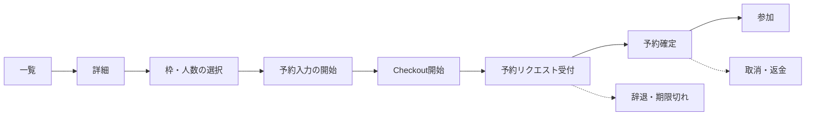

# 予約ファネルの計測設計

最終更新：2026-10-26（月次の検索・AI 回答の観測を追加）。対象：[#14](https://github.com/niho-life/niho-experience/issues/14)。
計測ツールの選定と実装は担当1、確定予約・売上・流入情報の保存は担当2。この文書はイベント契約と指標の定義を決める。

## 原則

- **確定予約と売上は共通基盤の確定データを正とする。** Checkout開始やStripeからの戻りURLを予約・売上として数えない。
- 計測に個人情報、予約token、非公開URL、決済セッションIDを送らない。
- 計測を拒否した人も同じように予約できる。計測の読み込み失敗で予約の操作を止めない。
- 分母・期間・重複排除・流入条件を指標ごとに記録する。

## ファネルの段階

L〜Cはブラウザの計測（cookieを使わない計測ツール。[analytics-decision.md](analytics-decision.md)）。R以降は共通基盤の記録（全件）。
リクエスト予約では、Rは「カードの与信と提供者への承認依頼」、Aは「提供者の承認と決済の確定」。即時予約ではRとAが同時に起きる。

## ブラウザのイベント（担当1が実装済み）

イベント名と値の正本は [docs/analytics-events.md](../analytics-events.md)（担当1、`apps/web/src/lib/analytics.ts`）。この文書の当初案（`slot_select` など）は実装の名前に読み替える。

| ファネルの段階 | 実装のイベント | 使う値 |
| --- | --- | --- |
| 一覧 | `list_view` | `result_count` |
| 詳細 | `experience_view` | `experience` |
| 枠・人数の選択 | `slot_continue` | `experience`、`guests` |
| 予約入力の表示 | `booking_form_view` | `experience`、`guests`、`total_jpy`（見積。売上ではない） |
| 予約入力を出せない | `booking_unavailable` | `experience`、`error_code` |
| Checkout開始 | `checkout_start` | `experience`、`guests`、`total_jpy`（同上） |
| Checkoutへ進めない | `checkout_error` | `experience`、`error_code` |
| 提供者向け | `host_view`、`host_start` | `signup_mode` |

当初案の `experience_card_click`（表示位置）と `checkout_return` は実装しない。決済後の状態はNIHOが表示し、このサイトでは支払結果を数えない。

### ファネルの分母と重複排除（担当1からの質問への回答）

Umami の `visitor` を単位にする。これは人そのものではなく、サイトID・hostname・User-Agent等と月初に変わるsaltから作るsession hashである（[公式のmetric定義](https://docs.umami.is/docs/metric-definitions)）。同じhashが月内の複数日に残ることがあるため、週や月を一度に指定したレポートでは期間中のvisitorとしてまとめて数えられ、「体験×visitor×日」の単位にならない。

| 率 | 分子 | 分母 | 重複排除 |
| --- | --- | --- | --- |
| 詳細→枠選択 | 同じ体験で `slot_continue` のあった訪問者 | 同じ体験で `experience_view` のあった訪問者 | 体験×訪問者×日で1回 |
| 枠選択→予約入力 | `booking_form_view` のあった訪問者 | `slot_continue` のあった訪問者 | 同上。人数を変えて見積を取り直しても1回 |
| 予約入力→Checkout開始 | `checkout_start` のあった訪問者 | `booking_form_view` のあった訪問者 | 同上。同じ見積で何度押しても1回 |
| Checkoutへ進めない割合 | `checkout_error` の件数 | `checkout_start` の件数 | 件数で数え、`error_code` 別に出す（入力不備での再試行も見える） |
| 予約入力を出せない割合 | `booking_unavailable` の件数 | `slot_continue` の件数 | 件数・`error_code` 別 |
| 予約確定率（visitor単位） | — | — | 算出しない。Umami visitorと予約は結合しない。UTM別集計を行う場合も、確定予約だけの集約値に限る |

- 期間はJSTの暦日。週次の振り返りは月曜0時〜日曜24時。
- Umamiでは各イベントstepに `experience` が対象slugと一致するフィルターを設定し、体験ごとに日次ファネルを実行する。Umami Cloudはファネルのstepごとのフィルターに対応している（[公式changelog](https://docs.umami.is/docs/cloud/changelog)）。
- 日次ファネルのvisitor数を週・30日分それぞれ合計し、率は合計した分子÷合計した分母で計算する。日ごとの率は平均しない。同じvisitor hashが別の日に再訪した場合は、その日ごとに1回ずつ数える。週・月の合計を「人数」とは表現しない。
- Umamiのファネルは順序どおりのstepを設定した `Window` 内に完了したvisitorを数える（[公式Funnel仕様](https://docs.umami.is/docs/funnel)）。初期の検証では隣接するstep間の `Window` を60分に固定し、週次記録にも設定値を残す。日をまたぐstepや60分を超えたstep間の遷移は、その日次ファネルの完了に含めない。
- NIHO運営の内部アクセスは計測ツールの「自分の訪問を除外」の機能で除く（[analytics-decision.md](analytics-decision.md)）。
- プレビュー（mock）のイベントは計測ツールへ送らない（担当1の実装どおり）。

### 送らないもの

氏名、メールアドレス、電話番号、備考欄（アレルギー等の健康情報を含みうる）、予約token、予約確認URL、Stripeのセッション ID、予約・決済ページのクエリ文字列を含む完全なURL、IPアドレスの保存。
予約入力・Checkout・予約確認のページではsession replayを使わない。v1ではsession replay自体を使わない案を推す。

## 共通基盤の記録（担当2）

| 状態 | 記録する時刻 | 集計に使う属性 |
| --- | --- | --- |
| 予約リクエスト受付 | requested_at | booking_id、experience、option、開催日、人数、見積額 |
| 予約確定 | confirmed_at | 確定額（税込・円）、販売・提供主体 |
| 辞退・期限切れ | declined_at / expired_at | 理由の区分 |
| 取消 | cancelled_at | 取消した側（旅行者・提供者・天候・最少催行未達）、返金額 |
| 参加・不参加 | 開催日の後 | 参加 / 不参加（提供者またはNIHO運営が記録） |

### 承認済みの予約流入元

オーナー決定（2026-10-20）：確定予約の集計用に、最初の流入URLから次の4項目だけをゲストCheckoutへ任意送信する。Do Not Track が有効なら送信しない。サイト内の画面遷移中だけメモリに保持し、cookie・session/local storage・訪問者ID・完全なURL・referrer・ページ種別は扱わない。

NIHOは受け取った値を予約行に保存し、既存の予約データ保持期間と閲覧権限を継承する。チャネル集計は確定した予約だけをUTM値のまとまり単位で集計する。Umami visitorとは突き合わせず、訪問者単位の予約率を算出しない。予約の確定件数・売上の正本は引き続きNIHOの予約・売上記録である。

## 流入の識別（UTM）

| パラメータ | 値の例 | 規則 |
| --- | --- | --- |
| `utm_source` | `niho_space`、`niho_instagram`、`niho_youtube`、`niho_line`、`niho_site`、`partner_a01` | 小文字・英数字・アンダースコア。提携先は公開文書では匿名のコード（a01など）にし、対応表は非公開台帳に置く |
| `utm_medium` | `qr`、`social`、`video`、`referral`、`email`、`print` | 媒体の種類。YouTube の説明欄は `video` |
| `utm_campaign` | `pilot_2026q4` | 検証の期間単位 |
| `utm_content` | `table_card`、`entrance_poster`、`story_1103` | 置き場所・投稿の区別 |

OTA経由の予約はOTAの管理画面で数える。OTAからこのサイトへの誘導は行わない（[pilot-30day-plan.md](pilot-30day-plan.md)）。
NIHO運営の内部アクセスは、計測ツールの「自分の訪問を除外」の機能で除く。IPアドレスによる除外は使わない。

## 指標の定義

期間の区切りはJST。ファネル指標は「その日に起きたイベント」で、取消・参加は「開催日」で数える。

| 指標 | 分子 | 分母 | 重複排除・注意 |
| --- | --- | --- | --- |
| ファネルの各率 | 上の「ファネルの分母と重複排除」 | 同左 | 同左 |
| 予約確定率（visitor単位） | 算出しない | — | Umami visitorと予約を同一人物として突き合わせない。UTM別集計は確定予約の集約値に限る |
| 承認率 | 予約確定 | 予約リクエスト受付 | リクエスト予約の商品だけ。booking_idで一意 |
| 客単価 | 予約確定の確定額の合計（税込・円） | 予約確定の件数 | 1予約あたりと1名あたりを両方出す。返金は別に集計 |
| 提供者対応時間 | confirmed_at − requested_at | — | 中央値と90パーセンタイル。予約前の質問への初回返信時間はNIHO運営の対応記録から |
| 取消率 | 取消された予約確定 | 開催日が期間内の予約確定 | 取消した側と理由で分ける |
| 不参加率 | 不参加 | 開催日が期間内で取消されなかった予約確定 | |
| チャネル別の予約数 | UTMがNIHO側に記録された確定予約だけ | — | NIHO v1.2の配備・実API確認後にUTMごとの集約件数を算出する。OTAはOTA管理画面の件数を別集計。UmamiのUTM別訪問を予約件数へ読み替えない |

### 週次・30日の突合手順

1. JSTの期間を固定する。Umamiは同じ期間の体験別・UTM別の日次イベントと60分Windowのファネルを記録し、計測できた訪問だけを数える。
2. NIHO共通基盤では、`booking_id` を一意キーに、同期間に `confirmed_at` が入った確定予約の件数と確定額（税込JPY）を出す。リクエスト受付、Checkout開始、決済復帰は含めない。重複webhookで同じ予約を二度数えない。
3. 取消・返金は別列で出す。期間中の確定額、期間中に実行した返金額、差引額を混同しない。取消率は開催日が期間内の確定予約を母数にし、申込日基準の確定件数と異なる集計であることを記す。
4. NIHO v1.2の予約行へのUTM保存が配備・確認されるまでは、**体験別のUmamiファネルと全件の確定予約・売上を横並びで報告**する。配備後は確定予約のUTM別集約件数だけを追加し、Umami visitorとの個人単位の突合や訪問者単位の予約率は出さない。OTAの予約はOTA管理画面とNIHO台帳の重複がないか運営が照合する。
5. 非公開台帳へ抽出日時、期間、時区、NIHO側の抽出方法・対象状態、UmamiのフィルタとWindow、除外条件、欠測を記録する。公開Issueには判断と未完了事項だけを書く。

## 検索・AI 回答の月次観測

[#155](https://github.com/niho-life/niho-experience/issues/155)。検索や AI 検索に紹介されることは保証できないので、月 1 回、同じ条件で観測して車線ごとの判断（[seo-growth-strategy.md](seo-growth-strategy.md) の「計測と見直し」）に使う。担当3 が授権なしで回せるよう、読むだけの作業に限る。

- **頻度**：月 1 回、月初の 1 週間のうち。前回と同じ条件で見る。
- **見るもの**：狙う語 30 本の順位（体験固有語・東京起点の体験語・計画段階の語・日本語）、AI 検索 10 問（ChatGPT・Perplexity・Google AI Mode）の引用元、Search Console（非指名クエリの表示回数・国別・「生成 AI 機能」レポート・指名 `niho experience`／`niho kamakura` の表示回数・第三者のリンク元ドメイン数）、Bing Webmaster Tools の AI Performance レポート。語と質問の一覧、記録の書式は非公開台帳（`YYYY-MM-DD-monthly-search-observation-setup.md`）にある。
- **条件**：英語は Google の米国・英国、日本語は Google の日本で、ログアウト（隔離したブラウザ）・個人化なしで見る。20 位までに無ければ「圏外」。AI には決めた英語の文をそのまま聞き、追加の質問はしない。IP の国を変えられないときは、その旨を記録する。
- **しないこと**：ログイン・アカウント作成、投稿・レビュー・フォーム送信、CAPTCHA の回避。CAPTCHA が出たらその媒体は欠測にする。Search Console・Bing は閲覧だけで、設定は [#141](https://github.com/niho-life/niho-experience/issues/141) の担当が行う。
- **記録**：上の突合手順の 5 と同じく、実施日時（JST）、環境（ブラウザ・ログイン状態・地域の指定）、Search Console の期間（太平洋時間で集計される）、サイトの状態（robots.txt・登録・sitemap）、除外と欠測を最初に書く。順位・引用元・競合名・Search Console の数値は非公開台帳の `YYYY-MM-DD-search-observation.md` に書き、#155 には判断と未完了事項を 1〜3 行で書く。
- **節目の起点**：「3 か月・6 か月・1 年」は、experience.niho.life の robots.txt が全面拒否から公開に変わり、sitemap を送った日（#141）から数える。それまでの観測は起点前の基準値。

## 同意と計測拒否

- v1の計測はcookieや端末への保存を使わない方式にし、同意バナーを出さない（[analytics-decision.md](analytics-decision.md)）。ブラウザのDo Not Trackの設定は尊重する。
- 計測の読み込みに失敗したり、ブロックされたりしても、予約入力・Checkout・確認への遷移は同じように動く。
- ブロックされた訪問は分母に入らない。報告では計測ツールの数字と、予約確定の総数（共通基盤、全件）を並べる。
- Do Not Track が有効なブラウザからは予約UTMも送らない。該当予約は流入元不明として扱い、予約操作は通常どおり続けられる。
- cookieを使う計測・広告タグ（GA4等）を入れる場合は、同意の取得（CMP）を先に設計する。

## 受入の確認

- 合成データで一覧→詳細→枠選択→Checkout開始までのイベントが、上の属性だけで送られることを確認する（担当1）。
- 送信内容に氏名・メール・電話・備考・token・決済IDが含まれないことを、開発者ツールの送信記録で確認する（担当1）。
- 計測をブロックした状態でCheckoutまで進めることを確認する（担当1）。
- 予約確定の件数と金額を共通基盤から取得し、Checkout開始の件数と別に報告できることを確認する（担当2）。
