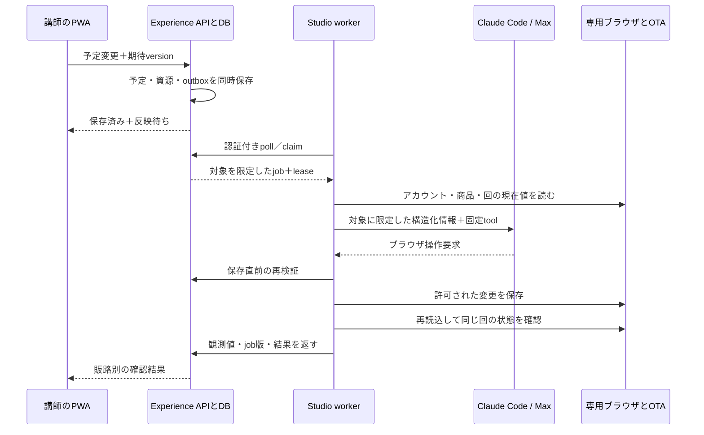

# NIHO Experienceの予定変更をMac StudioとClaudeで外部サイトへ反映する設計

作成日：2026-10-29。状態：実装・実機実証へ進むための詳細設計。オーナーは本方式と規約上の許可取得を明示済み。許可の取り直しを着手条件にせず、対象アカウント・商品・操作範囲を設定として記録する。初稿時点の構成を記録し、実装・実証の現在値は次節を正とする。

関連：[全体の運営設計](../idea/active/2026-10-29-ota-calendar-operations.md)、[サイト別の登録方式](growth/ota-account-registration-and-operating-models.md)、[ADR 0002](adr/0002-experience-domain-ownership.md)、[設計PR #183](https://github.com/niho-life/niho-experience/pull/183)、[実装Epic #194](https://github.com/niho-life/niho-experience/issues/194)。実装Issueの一覧は末尾。

## 2026-10-29の確定事項と実証

- オーナー決定：**Claude Code／Maxの既存契約内で実行し、従量APIへ切り替えない**。通常の既知の枠開閉はNIHOのbrowser driverで実行し、Claude modeも同じ限定操作だけを利用する。
- ホストカレンダーの単発・繰返し枠、日時変更と販売状態の分離、保存とoutboxは[PR #207](https://github.com/niho-life/niho-experience/pull/207)でマージ済み。掲載先registry、worker認証、耐久job、lease、readbackは[PR #209](https://github.com/niho-life/niho-experience/pull/209)でマージ済み。Studio workerは[PR #218](https://github.com/niho-life/niho-experience/pull/218)。本番runtimeはOFFのまま。
- Studioの専用Chromeへ本人がログイン済み。許可済みのGetYourGuideの空き枠を、停止→再読込→再開→再読込で**5往復、計10書込み**し、元の受付可能な状態へ復元した。これはdriver単体の実証であり、PWAからの結合やClaude推論を通した実証ではない。
- StudioのNode 24／Chrome 156で合成24ケースを確認。加えて主担当の実ブラウザテストで20回の連続開閉、応答喪失後の読戻し、誤商品・認証失効・古いpreflightの拒否を確認した。モデル呼出しは0回。
- Claude Code 2.1.292のMaxログインは確認済みだが、推論は週間上限で停止した。quota回復前にClaude経由の20件成功とは扱わず、従量API fallbackもしない。
- 合成専用DBの実認証API→暗号化SSHのloopback転送→Studioの新worker→実GetYourGuideで、状態確認・停止・再開・結果保存を実証。25.103秒／37.741秒／34.342秒で完了し、すべてstopped=true・acceptedAsCurrent=true、最後は元のOPENへ復元。PWAと公開cloud originは含まない。詳しくは[workerの証跡区分](ota-worker.md#証跡の区別)。
- Studioから公開originへの再確認はGET 200、新job APIは未配備の404。独立した合成DBの検証APIでは認証なし401、無関係jobの操作403を確認。公開cloudでの認証付きjob処理は別の受入項目である。
- 体験限定の運営者招待、1回1組・講師／会場の共有在庫、外部予約取込み、第二サイト、旧外部枠の退役、本番有効化は未完了。実アカウントID・資格情報・画面証跡は公開リポへ置かない。

## 1. Goal：成立させる操作

講師はNIHOの自分のアカウントでPWAのカレンダーを開き、担当する体験の開催枠を作る・休止する・再開する。NIHOスタッフは掲載先とアカウントの対応を設定する。Studioはクラウドに保存された変更を取得し、Claudeとブラウザで対象サイトの枠を更新する。PWAを閉じても処理は続く。

初期は1回1組、人数可変。水引・書道・料理が同じ部屋を使う場合、別商品でも同時刻の予約は競合する。外部サイトで予約が入ったときもNIHOへ取り込み、他販路・共用資源の販売を止める。

**実現可能性の結論**：Claude Code／Maxと自前の限定ブラウザ実行部で構成する。既存のClaude Desktop画面や未確認の「Claude app server」にイベントを投げるだけでは完成しない。NIHO専用の常駐worker、永続ジョブ、ブラウザdriver、サイト別adapter、反映確認が必要。各OTAの実画面での安定性はPoCで実証する。

## 2. Current system：確認できたこと

### 2.1 コード上の組み込み位置

調査対象：設計ブランチの `a3378df`。後続実装時は最新mainとの差分を再確認する。

| 現在の部品 | 変更点 |
| --- | --- |
| `apps/web/src/app/(host)/host/calendar/data/route.ts` | POSTの結果を「NIHOに保存」と「販路反映」に分ける。ブラウザ処理の完了までHTTPを待たせない |
| `apps/web/src/lib/experience/host-actor.ts` | 現在はNIHO側provider所属が入口。担当商品だけの運営者が入れる認可を追加 |
| `packages/experience-store/src/repository.ts` の `saveScheduleRule` / `saveOccurrenceOverride` | 同一DB取引で予定変更とoutboxイベントを保存。現状は枠保存からOTAジョブを作っていない |
| 同 `confirmBookingPayment` | 既存outbox書込みを参考にする。外部予約をStripe支払済み予約へ偽装しない |
| `packages/experience-store/migrations/0001_experience_store.sql` | provider単位権限、予定ルール・例外・開催回、予約、outboxがある。外部接続と実行状態を別テーブルで追加 |
| `packages/google-calendar` / `google-connection` | busy取得の部品を再利用。現状のprovider単位設定を講師・会場の資源へ対応付ける |
| PWA #177、設定 #109 | manifest等は再作成しない。ジョブ状態・通知の接続と、移行後の権限に合わせる |

既存の予定例外は予約がある回の変更を拒否する。**販売停止と催行取消を別操作にする**。予約済み回の追加受付を止めるために、予約そのものを消す・日時変更する必要はない。

### 2.2 Studioの読み取り専用確認

2026-10-29に既存の接続診断を実施。ホスト鍵検証付きSSHと既存実行helperへの到達を確認した。秘密・顧客情報・ブラウザ履歴は取得していない。

| 項目 | 確認結果 | 意味 |
| --- | --- | --- |
| 実行機 | macOS ARM64 | Studio上での実行環境は存在する |
| Chrome | 156.0.8078.49、専用profile | 本人ログイン後のGetYourGuide既存回で5往復。任意の商品作成まで対応済みとはしない |
| Claude Code | 2.1.292、Maxの公式ログインを確認 | 推論は週間上限。APIキーを抽出・転用せず、追加課金へfallbackしない |
| Node | 24.18.0で実証 | workerはNode 24を明示指定。システムNodeを変更しない |
| GUIドメイン・既存agent hub | 存在を確認 | 専用運用アカウント・再起動後の利用可否は未検証 |
| Studio→体験サイトの公開origin | 再確認GET 200、新job APIは未配備の404 | 公開originでの認証付きjob処理は未実証。合成DBの別検証APIは401/403拒否を確認 |
| Studio→Claude APIのorigin | TLS/HTTP応答あり、ルートHEADは404 | ネットワーク到達だけ。API認証・課金・tool呼出しは未検証 |

**初稿時点の未実証項目**：クラウドジョブの取得、Claude推論、専用ブラウザの操作、OTAログイン、枠保存、保存結果の確認。上の更新節のdriver単体実証と区別する。常駐サービスの設置・再起動・public cloudとの結合は引き続き受入が必要。

## 3. Options：Claudeの実行方式

| 案 | 構成 | 判断 |
| --- | --- | --- |
| A | Messages APIの公式SDK＋ブラウザtoolset＋NIHOのdriver | 初期非採用。従量APIキーが必要で、今回の追加API課金なしという決定に合わない |
| B | **Claude Code／Max＋限定MCP＋NIHOのdriver** | 採用。公式ログインをGUI実行環境で利用。shell・任意URL・任意JavaScriptを渡さず、3つの固定toolに限定 |
| Bの通常処理 | NIHOのdeterministic browser driver | 既知の開閉ではモデルを呼ばず同じ認可・保存直前検証・再読込を使う。Claude modeもこのdriverの外へ操作を広げない |
| C | Claude Desktopを画面操作して仕事を投入 | 採らない。会話の送信と仕事の受付・完了を機械的に管理しにくい |

Anthropic公式は、Python／TypeScript SDKのbrowser toolset、tool runner、および利用者が用意するdriverという境界を説明する。CDPを使うサンプルもあるが、サンプル自体は本番用コードではない。Agent SDKは別のライブラリであり、自動的に既存のChromeへつながるものではない。[Browser SDK](https://platform.claude.com/docs/en/agents-and-tools/tool-use/browser-use-sdk)、[Agent SDK](https://code.claude.com/docs/en/agent-sdk/overview)

### 採用する実行部

- Node 24のworker packageを同じリポへ追加する案とする。CLI、ブラウザdriver、ブラウザ版をPoCで検証し固定する。可変latestを本番で自動追従しない。
- Claudeの仕事は画面を読み、許可した操作を選ぶこと。jobの対象・期限・権限・成功判定は通常コードが管理する。
- browser toolsetのdriverは専用Chrome/Chromiumを操作する。DOMで安定して識別できる部品は意味の分かるlocatorを使い、必要な部分だけ画像・座標操作にする。任意コード実行をClaudeへ渡さない。
- モデルを起動するのは実行が必要な差分がある場合だけ。空のpoll、版比較、予約の重複排除、通知振分けでは呼ばない。
- Maxの公式ログインをClaude Code自身に利用させる。CLIの認証情報を抽出・APIへ転用しない。`--tools ''`、strict MCP、hooks無効、固定3toolを設定し、追加API課金へのfallbackを拒否する。quota・利用条件に従い、上限時は停止する。[CLI](https://code.claude.com/docs/en/cli-reference)、[MCP](https://code.claude.com/docs/en/mcp)、[Claudeプランでの利用](https://support.claude.com/en/articles/15036540-use-the-claude-agent-sdk-with-your-claude-plan)

## 4. User journey：保存と反映を分ける

1. 講師が「11月7日13時の水引を休止」を選ぶ。
2. サーバーが担当権限、既存予約、会場、日時、期待versionを検証する。
3. 予定とoutboxを同時に保存。PWAには「保存しました。掲載先に反映中」を返す。
4. Studioがクラウドからjobを取得し、対象の外部アカウント・商品・回を照合する。
5. Claudeが画面を操作。保存直前に現在の希望状態と権限を再確認する。
6. 保存後に再読込し、同じ回が受付停止になったことを読み戻す。
7. クラウドが現在版と照合し、「Airbnb：反映確認済み／アソビュー：反映中」のように表示する。

保存の競合は409と最新状態を返す。通信失敗・オフライン時は保存済みと表示しない。予約がある回の休止は「追加受付を停止」であり、催行予約の取消は別の業務操作とする。



## 5. Recommendation：クラウドからStudioへの信号

### 5.1 通信方向

**Studioから外向きHTTPSでjobを取りに行くpull方式**を採る。「PWAで変更したらStudioが動く」という体験を、DB保存とpollで実現する。Studioへの着信ポート・公開SSH・ブラウザ制御ポートは不要。PWAのWeb Pushやservice workerを実行トリガーには使わない。

pilotの初期値は待機時15秒間隔（常時なら最大5,760回/日）、jobがあれば処理後すぐ次を取得。一時障害は15→30→60秒へbackoffしjitterを入れる。pollは短いHTTPS要求で、空なら204。モデルは起動しない。長時間HTTP接続・WebSocket・専用brokerは必要性を測ってから追加する。

Cloud Runのレスポンス送信後にメモリ上の非同期処理を放置しない。予定変更で永続outboxを作り、claim要求内の上限付き取引でjobへ展開する。別途クラウド側のwatchdogが滞留・worker欠落を検知する。[Cloud RunのHTTPSと認証](https://docs.cloud.google.com/run/docs/triggering/https-request)

### 5.2 API案（すべて未配備のv1契約案）

| API | 主体・役割 |
| --- | --- |
| `/host/api/channel-calendar/commands` | 人のセッション。枠作成・休止・再開、期待version、冪等command IDを受ける |
| `/host/api/channel-calendar/status` | 自分の担当商品だけの予定・反映状態を返す |
| `/admin/api/channel-accounts` / `channel-listings` | 外部アカウント、①〜④、商品対応、委任、対応操作を設定 |
| `/internal/ota/v1/claim` | worker専用認証。対象アカウント内の次のjobを原子的に取得。空なら204 |
| `/internal/ota/v1/jobs/{id}/renew` | worker ID・lease ID・epochを検証して延長。長い実行中は30秒ごと |
| `/internal/ota/v1/jobs/{id}/preflight` | 保存直前のdesired版、対応表、委任、予約、資源、停止状態の検証 |
| `/internal/ota/v1/jobs/{id}/result` | 観測結果・エラー分類を冪等に受理。古いleaseは現在状態を成功へ変更できない |
| `/internal/ota/v1/reservation-observations` | 割り当てられた接続の外部予約観測を受理。一般の予約操作APIではない |

既存のカレンダーPOSTも同じcommand serviceへ寄せる。新旧routeで認可・資源計算・outbox発行を二重実装しない。

パス名・DTOは実装Issueで契約テストとともに固定する。worker認証は人のhost/Admin cookieから独立。初期案は256bit以上のランダムなworker専用credentialをTLSのAuthorizationヘッダーで使い、サーバーはhashと割当scope・期限・失効状態を持つ。tokenはURL・job・LLM入力・ログへ入れない。登録・交換・失効は管理手続で行う。資格情報の持主はworkerで、Claudeモデルではない。

公開originで観測した403は、WAF・アクセス制御・要求方式等のどこで返ったか未確定。機械向けpathを正式に配備し、有効credentialで200/204、不正credentialで401/403になることを確認する。解決のためにサイト全体の防御を無効にしたり、未知のoriginを迂回路にしたりしない。

### 5.3 jobの内容

下記は合成例。外部管理画面URLは利用者入力をそのまま信じず、登録済みadapterと対応表から生成する。

```json
{
  "schemaVersion": 1,
  "jobId": "job_example",
  "accountId": "account_example",
  "listingId": "listing_example",
  "optionId": "private_example",
  "occurrenceId": "occurrence_example",
  "operation": "SET_CLOSED",
  "desiredVersion": 12,
  "mappingVersion": 3,
  "startUtc": "2026-11-07T04:00:00Z",
  "endUtc": "2026-11-07T05:30:00Z",
  "timeZone": "Asia/Tokyo",
  "groupCapacity": 1,
  "maxParticipants": 6,
  "adapterVersion": "pilot-1"
}
```

lease token・締切・worker scopeは機械用envelopeで管理し、モデルには渡さない。初期操作は `OBSERVE` / `SET_CLOSED` / `SET_OPEN`。新規回作成 `ENSURE_OCCURRENCE` は別の能力として受入する。価格変更、予約取消、返金、入金先、契約、顧客送信は対象外。

## 6. データ・排他・状態遷移

### 6.1 正本とイベント

- 正本はExperience DB。講師・会場・商品・開催回の既存モデルを再利用し、別カレンダーDBを作らない。
- 予定ルール変更、例外、休止、講師・会場の変更、NIHO直販の仮押さえ・確定・失効・取消、外部予約の新規・変更・取消、Google busy更新を再計算の入力とする。
- 影響する資源と時間範囲から各掲載の希望状態を求め、単調増加の `desiredVersion` を振る。別商品の予約が同じ部屋を使う場合も対象に含める。
- 書込みとイベントは同じDB取引。rule変更は今後8週間のpilot範囲へ上限付きで展開し、無限の開催回を作らない。時間経過による対象期間の延長・受付締切到来も再計算する。
- 既存outboxの単一 `processed_at` をOTAだけが消費して通知処理を失わせない。topicごとのdispatchを決め、必要なら `outbox_deliveries(event_id, consumer)` を一意にする。#177の通知consumerと契約を共有する。

### 6.2 追加する論理データ

| データ | 重要な制約 |
| --- | --- |
| 体験運営者・招待 | NIHO user＋担当商品。有効期間・失効・招待受諾。provider全体の権限へ昇格しない |
| 外部account / listing | 所有者・①〜④・委任staff・操作範囲・外部ID・adapter版。対象IDは一意に対応 |
| 希望状態 / 観測状態 | 希望の版、OPEN/CLOSED、理由、確認日時、確認した外部状態を分ける |
| job / attempt | operation、冪等キー、priority、notBefore、deadline、lease、epoch、現在状態、試行履歴 |
| worker / account lock | 有効scope、heartbeat、実行中のaccount、profile、停止確認状態。秘密は保存先を分離 |
| 外部予約 | site＋account＋外部予約IDを一意に。revision、商品・日時・人数・組、状態、検知元・照合時点 |
| 資源占有 | 講師・部屋・設備、準備片付け時間。確定・期限付き仮押さえを同一取引で競合検査 |

### 6.3 実行状態

`QUEUED → LEASED → RUNNING → VERIFYING → VERIFIED` を基本に、`SUPERSEDED`、`RETRY_WAIT`、`AUTH_REQUIRED`、`NEEDS_REVIEW`、`UNKNOWN_AFTER_SAVE` を分ける。

1. claimはDBのrow lockと条件付き更新で原子的に行う。初期は全体のブラウザ実行を1件、同じaccount・profileを必ず1件に限定する。
2. leaseは120秒、30秒ごとに延長。job全体の初期上限は180秒、browser actionは最大40回。値はPoCで調整し版管理する。
3. 60秒間renew成功が得られなければ新しい変更操作を止める。lease切れだけで別workerへ同じaccountの書込みを渡さない。
4. 旧processとブラウザの停止をStudio supervisorが確認するまでaccountを隔離する。停止確認が取れない場合は人へ引継ぎ、再起動後も先に現状を照合する。
5. 保存直前にpreflightを行う。古いOPEN、mapping変更、委任失効、予約・会場競合、受付締切、運用停止なら保存しない。
6. 保存と結果返却の間で停止した場合はUNKNOWN。再試行は必ず読取りから始め、結果が既に一致すれば再変更しない。
7. 結果の版が現在と違えば観測履歴としてのみ記録する。新しいCLOSEDがあるのに古いOPENの結果で緑表示にしない。

OTAに共通トランザクションやfencing機能はない。内部の排他は旧ブラウザの書込みを物理的に取り消せない。最後のpreflight後にも外部予約は入り得るため、**exactly-onceや二重予約ゼロをブラウザ方式の保証にしない**。

閉鎖jobを開放より優先し、同一回の連続編集は最新状態へ集約する。原則は現在の観測値から希望状態へ設定し、「クリックして反転」命令を再送しない。受付停止と定員0を同一視せず、取消時の在庫復元後も休止を保てるか受入する。

## 7. Studio supervisorとブラウザadapter

### 7.1 常駐構成

`supervisor → job executor → Claude Code／Max（必要時）＋browser driver` の3境界にする。supervisorはpoll・lease・再試行・予算・process停止を管理し、モデルへshellを渡さない。

初期案は**専用OSユーザーと専用作業ディレクトリ**。既存の開発・配備ユーザーの鍵、リポジトリ、個人Chrome、既存CIのブラウザを共有しない。既存のmachine execution registryには本用途の常駐ブラウザworkerは未定義なので、配備Issueで実行クラス・所有者・trust boundaryを追加する。

通常は画面なしの専用ブラウザを検証する。OTAが画面付きChromeを要する場合は専用GUIセッションを使い、OSログイン・画面ロック・ログアウト・再起動時の挙動をPoCで測る。macOSのLaunchDaemonとLaunchAgentのどちらを使うかはこの結果で固定する。CLIの認証やkeychainが必要な代替案は既存GUI hubの手順に従うが、開発用hubに本番のOTAセッションを混在させない。

FileVault解除前・OSログイン前の再起動では無人復帰できない場合がある。自動ログインや暗号化解除を復旧策にせず、クラウドから欠落を検知し、復旧担当へ通知する。

### 7.2 profileとログイン

- 外部accountごとに専用profile。初期ログイン・2FAは担当スタッフが行う。通常運転で毎回ID・パスワードを入力させない。
- cookie、storage state、APIキーは秘密として専用保管。Git、ジョブ、モデル入力、スクリーンショット添付、公開Issueへ流さない。[Playwrightの認証状態](https://playwright.dev/docs/auth)
- Chromeの既定profileへ接続しない。Chrome 136以降はremote debuggingに非標準のuser data directoryが必要。[Chrome公式](https://developer.chrome.com/blog/remote-debugging-port?hl=en)
- 制御は可能ならpipeを使う。CDP portが必要ならloopback限定・外部非公開。OTAから開くページがローカルの制御portや他サービスへ到達しないようdriver外の境界も設ける。
- 認証期限切れ・CAPTCHA・新しい同意画面はAUTH_REQUIRED。NIHOスタッフが専用セッションへ入り、解除後に現在状態の照合から再開する。全ジョブで無限再ログインしない。
- 同じprofileを人が編集するときはaccountを手動対応中にし、実行停止を確認してから引き継ぐ。

### 7.3 サイト別adapterの責務

```text
probeAccount()            -> 外部account IDと権限・認証状態
locateOccurrence(target)  -> 商品・option・現地時刻・外部回ID
observeAvailability()     -> 販売状態、組/人数、予約有無、観測時点
planChange(desired)       -> 変更箇所と保存対象を限定した計画
applyChange(plan)         -> サーバーpreflightの後に実行
verifyAfterReload()      -> 同じ対象を再読込して独立に判定
observeReservations()    -> 対応する場合だけ、予約の観測
```

account名だけ、商品名だけ、カレンダーの色だけで対象を決めない。外部ID、option、日付・時刻、タイムゾーンの一致を確認する。画面から十分に確認できないadapterはNEEDS_REVIEWへ送る。

成功はClaudeの「完了しました」という文章では決めない。driver／adapterが検証した構造化観測値、対象ID、版、確認時刻をクラウドで検証する。画像だけで確実な判定ができない画面は確認不能と返し、成功扱いしない。必要な証跡は非公開へ短期間保存する。

URL allowlistだけでは、同じドメイン内の口座変更・予約取消まで防げない。許可画面と変更対象、書込み先のmethod/path・payloadの形を検証し、価格・予約取消・メッセージ送信等をdriver側で拒否する。汎用クリックだけでは操作を限定できないサイトは、その時点で無人保存を有効にしない。

読み込んだページ本文・予約者メッセージを命令として扱わない。アップロード・ダウンロード・任意JavaScript・外部URL遷移は既定OFF。認証に必要なSSO/CDN等は観測して明示設定し、外部への通信制限はブラウザ内だけに依存しない。SDKのnavigate用URL policyだけではリンク・redirect等を完全には制限しない点も実装時に確認する。[SDKの境界](https://platform.claude.com/docs/en/agents-and-tools/tool-use/browser-use-sdk)

### 7.4 新しい開催枠を作る

初期pilotではサイト側に既存の回を用意して開閉から始める。ただし最終スコープには「NIHOで枠を作る→掲載先に回を作成」も含める。

`ENSURE_OCCURRENCE` はaccount＋listing＋option＋開始時刻等で既存回を探し、存在しないと確認できる場合だけ作成する。保存直後に停止しても、再実行時に同じ回をもう一度作らない。複数候補・異なる価格・定員がある場合は停止。新規回作成に非対応の販路はUIに明示し、枠作成済み・反映済みと偽らない。

## 8. 外部予約とGoogle Calendar

### 8.1 予約の逆方向取込み

予約API/webhook、公式出力、通知メール＋管理画面照合、許可された画面読取りの順に採用する。確定・取消・日時変更を外部予約IDで統合し、サイトからのメール到着順を更新順序とみなさない。

NIHOから予定を編集しない間も予約検知は動く必要がある。通知を受けたら優先照合を投入し、通知欠落に備えて接続ごとの `nextReconcileAt` から予約照合jobを生成する。初期案は5分間隔、未催行予約と直近変更を重なりのある期間で読む。専用API等がない場合はブラウザ費用・処理時間・予約方式をPoCで評価する。前回成功時刻、照合範囲、次回予定をUIへ返し、取得失敗を「予約なし」に変換しない。

メールは専用受信口・接続に結びつけ、送信元認証と外部予約IDを検証する。顧客が書いた本文や転送メールだけで取消・再開を確定しない。確度が足りない通知は一時的な停止理由として保持し、画面等の照合後に確定する。安定したrevisionがないサイトでは最新状態を読み直し、取消先着・日時変更による旧枠と新枠の両方を扱う。

外部予約を受けたら、実際の販売者・外部決済であることを保ち、講師・会場・設備を占有して他販路を再計算する。取り込み済み予約をStripeで再課金しない。競合した2件目を削除したり、モデルが自動で取消したりしない。

外部予約は成立直後からStudioの画面操作完了まで遅延がある。厳密な二重予約防止が必要な商品は、予約リクエストをNIHOで一元承認するか、予約時に同じ在庫をロックできる公式接続が必要。サイト専用枠を使う場合は共有枠との違いを明示する。

### 8.2 Googleの扱い

- PWAを主操作画面にし、Googleは任意のbusy入力と予約表示に使う。Google上の通常の予定から販売商品や料金を推測して作らない。
- Google busyは講師／会場資源へ対応付ける。更新を受けたら希望状態を再計算し、同じjob経路でOTAを更新する。
- Googleからの入力用カレンダーと、NIHO予約の出力・Airbnb用bridgeカレンダーを分離する。freeBusyだけでは自己出力eventを識別できないため、初期は同じカレンダーを入出力に使わない。
- watch通知だけに依存せず、接続更新・差分／busy再取得・定期照合を設計する。取得失敗やcoverage外では開放しない。
- Airbnb公式Google連携は選択可能なadapter。**同じ外部掲載へGoogleとブラウザを同時に書き込ませない**。接続方式を変えるときは停止→観測→方式切替→再照合する。
- Googleのbusy削除は空き候補を再計算するだけ。予約、手動休止、会場競合、締切が残っていれば開放しない。[Google push通知](https://developers.google.com/workspace/calendar/api/guides/push)、[AirbnbのGoogle連携](https://www.airbnb.com/help/article/2822)

## 9. 監視、失敗、費用

| 事象 | 自動処理と人への表示 |
| --- | --- |
| Studioのheartbeatが90秒以上古い | 新規OPENを保留。独立したクラウドwatchdogが検知し、スタッフへ通知 |
| Studio停止中に予約が到着 | クラウドで取込み・占有・閉鎖jobを記録。外部を閉じたことにはしない |
| 外部を閉じられない | 未反映サイトと回を示し、スタッフが手動停止。復旧時は手動変更を取り込んで再開 |
| 保存後の通信切断 | UNKNOWN_AFTER_SAVE。読取で確認するまでOPEN/CLOSEDの成功表示をしない |
| 画面・SDK・モデル版が変化 | 接続部を停止し再受入。対象ID不一致なら別商品へ進まない |
| 取消で在庫復元 | 手動休止を保持する停止方法を使う。保持不能なら共有在庫の適合を再評価 |
| 予算・時間上限 | 新規OPENを保留。CLOSEDは事前設定した緊急枠の範囲で優先し、超過時は即手動対応 |

**Studioが止まった時に、既に開いている全OTA枠が自動で閉じる保証はない。** NIHO直販と新規開放は止められるが、外部への最後の書込みには実行機かスタッフが必要。これを障害画面と運用手順に明記する。

watchdogはStudioとは独立したクラウドの実運用jobとして設計する（例：1分間隔）。この設計作業でCodexの定期タスクや本番schedulerを作成するものではない。通知consumerは滞留時間・未閉鎖数・担当を持ち、同じ障害の通知を重複連発しない。

初期は既存Max契約を利用し、従量APIへの追加支出は0円とする。既存契約料、端末・通信・基盤費、手動保守は残る。モデル呼出し回数・tool回数・処理秒数・失敗率・quota停止を計測し、追加課金で上限を回避しない。通常driverはモデル呼出し0回で動かす。

## 10. PoCと本番受入の段階

| 段階 | 実証すること | 合格基準／成果物 |
| --- | --- | --- |
| T0 機械認証 | Studio→新しいjob API→結果返却 | 正規credentialだけ200/204。不正・失効・別accountは拒否。公開originの403の切り分けを記録 |
| T1 合成画面 | 合成OTA画面でClaudeが開閉・保存・再読込 | 正常系20回で対象違い・誤成功0。認証切れ、画面変更、保存後切断、古いOPENを注入して期待状態へ |
| T2 実サイト1つの読取 | 専用profileでログインし、対象account・商品・回を識別 | 外部ID・時刻・状態を構造化して返せる。販売変更はしない |
| T3 実サイト1つの開閉 | 予約がない検証回を停止・再開 | 各5回の往復で保存後の再読込が一致。実予約の取消や課金を試験に使わない |
| T4 予約の往復 | 各社の試験方法／合成イベントで予約→他販路停止→取消→条件付き再開 | 重複・遅延・取消先着・2サイト同時予約・会場共有を検出 |
| T5 障害復旧 | worker停止、通信断、OS再起動、ログイン失効 | 古いOPENを再生しない。外部未閉鎖を通知し、照合後だけ復帰 |
| T6 pilot | 1商品・1組制・8週間以内・2販路 | 誤対象操作・誤成功0。反映時間p95 180秒以内を初期目標として実測し、予約方式の妥当性を判断 |

T3の再開は検証用の回・販売条件を決めてから実施する。単に未来の日時だからテスト用とみなさない。アカウント登録・契約・決済・顧客への通知は試験用操作へ含めない。

PoCで記録する版：実行SHA、Node、SDK、browser、driver、adapter、model。機密を除いた集計をIssueへ、cookie・顧客画面・資格情報は非公開へ置く。20回の成功を長期無故障の保証とはしない。

## 11. Open questions：実機で決める項目

設計・起票を止めるオーナー確認は不要。規約許可は取得済みとして扱う。次の事項はPoCまたは配備の具体作業で埋める。

- 最初の外部accountと検証回：GetYourGuideを選定し、本人ログインと既存の空き枠5往復を実証済み。第二サイトは実アカウントの準備状況で選定する。
- Max公式ログイン、専用profile、GUI／headlessの適合、再ログイン手順。APIキーの新規設定は行わない。
- 403の発生箇所、機械向けpathの配備・認証・WAF設定。対象を限定して直す。
- 会場・講師の同時利用条件と準備片付け時間。初期は共用会場1組。
- 予約取込みの実際の通知方式と許容遅延。サイトごとの即時／リクエスト方式。
- 実費、速度、失敗率を基にしたjob上限・予算・監視値。

## 12. Next steps：実装Issue

親は[実装Epic #194](https://github.com/niho-life/niho-experience/issues/194)。まずP0で「本当に動くか」を実証し、権限・データ・実行部を実装する。P0の前提調査だけで全サイト対応済みとはしない。各Issueに実装範囲・依存・受入条件を記載済み。

| 記号 | 作業 | 依存 |
| --- | --- | --- |
| [P0 #195](https://github.com/niho-life/niho-experience/issues/195) | Studio・Claude・ブラウザ・クラウド信号のPoC | なし。設計PR #183参照 |
| [P1 #196](https://github.com/niho-life/niho-experience/issues/196) | 体験限定の運営者招待と外部account/listing台帳 | #84・ADR 0002と整合 |
| [P2 #197](https://github.com/niho-life/niho-experience/issues/197) | 1組制・共有資源・予定変更outbox | P1 |
| [P3 #198](https://github.com/niho-life/niho-experience/issues/198) | worker API・永続job・lease・結果確認 | P1、P2。P0結果を契約へ反映 |
| [P4 #199](https://github.com/niho-life/niho-experience/issues/199) | Studio supervisor・Claude driver・枠作成／開閉adapter | P0、P3 |
| [P5 #200](https://github.com/niho-life/niho-experience/issues/200) | 外部予約・取消・変更の取込みと他販路閉鎖 | P1、P2、P3。P4と接続 |
| [P6 #201](https://github.com/niho-life/niho-experience/issues/201) | Google busy・資源対応・Airbnb公式経路 | P2、P3、既存#109を拡張 |
| [P7 #202](https://github.com/niho-life/niho-experience/issues/202) | PWA/Admin反映状態・監視復旧・2販路pilot | P0〜P5、Google採用時P6。#177と整合 |

P1/P2はP0と独立に設計を進められる。P0が不成立なら、その理由に応じてdriver・実行環境・接続方式を変更し、実証せず本番展開へ進まない。起票単位と現在の実装・実証は冒頭の更新節を照合し、本番有効化と混同しない。
