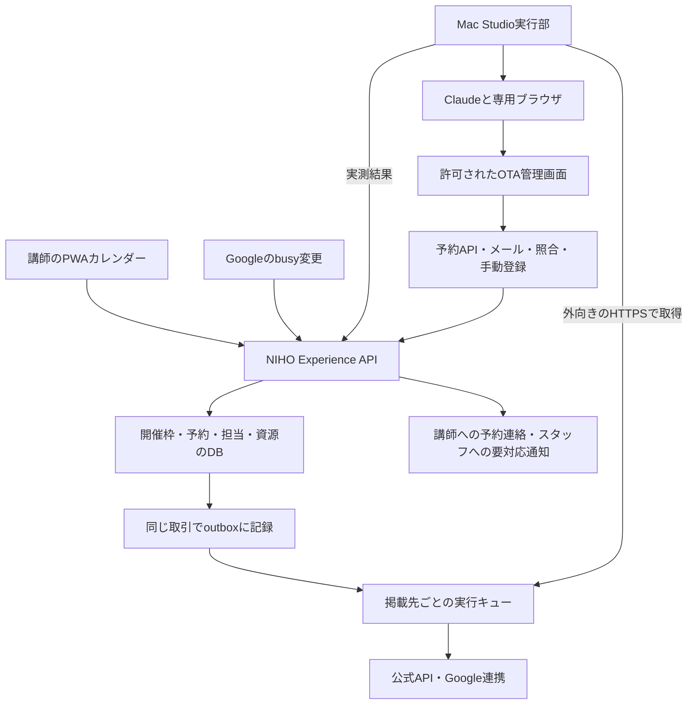

# NIHO Experience：講師別カレンダーと外部予約サイトの運営設計

作成・一次資料確認：2026-10-29。状態：**詳細設計と段階実装。現在の実装・実証はStudio worker設計の冒頭を正とする**。

同日追記：オーナーから本方式と規約上の許可取得を確認済み。Studioの常駐構成・API・排他・実証手順は[Studio worker詳細設計](../../docs/ota-studio-worker-design.md)を正とする。初期案のMessages API方式は採用せず、Claude Code／Max契約内で実行する。カレンダー基盤はPR #207でマージ済み、GetYourGuideはStudioの専用profileで5往復し元へ復元済み。PWAからの結合・Claude推論・共有資源と外部予約取込みは未完了。以下の現状欄は初稿のコード調査基点を示す。

関連：[#84 ホスト画面](https://github.com/niho-life/niho-experience/issues/84)、[#177 PWA](https://github.com/niho-life/niho-experience/issues/177)、[ADR 0002](../../docs/adr/0002-experience-domain-ownership.md)、[市場・販路調査](../../docs/growth/kamakura-experience-market-and-channels.md)、[API接続の調査](../../docs/growth/niho-channel-manager-feasibility.md)。現状コードの確認基点：`0f4bd96c1d948d426a32112ee99eb327361586fa`。

公開文書の講師A・B・C、日程、数値は設計用の例。実アカウント、本人確認書類、メール、予約情報、端末の接続情報をここへ記録しない。

## 1. Goal：目的と今回の判断

講師はNIHO ExperienceのPWAに自分のNIHOアカウントで入り、担当する体験の開催枠を作る・休止する。NIHOが各予約サイトの掲載、アカウント、予約連絡、カレンダー反映をまとめて支援する。有料チャネルマネージャーの導入を前提にせず、既存のMac StudioとClaudeを操作実行側に使う。

### オーナーの意向

- 外部サイトは、可能ならNIHO名義の事業者アカウントに複数の体験を登録する。例：水引、書道、料理。
- 個別アカウントが必要なサイトは、NIHOが作成・掲載を手伝う。講師の登録作業を最小限にする。
- NIHO ExperienceではNIHOがコンテンツを作り、講師をそのコンテンツの運営者として招待する。
- Adminで「コンテンツ・運営者・外部サイト・事業者アカウント・掲載ID」の関係を管理する。
- カレンダーの変更をNIHOが検知し、Mac StudioのClaude実行部へ渡す。
- 規約上の許可は取得済みとのオーナー申告を前提に進める。対象アカウント・商品・操作範囲を台帳へ記録し、実機能力をサイトごとに検証する。
- 2026-10-29追記：名義・入金先はまず簡単な構成とする。代理販売とNIHO販売＋実施委託のどちらも選択肢とし、不要な税負担を避ける。

### 推奨する初期形

**NIHOが自ら販売・運営するワークショップを、講師に実施委託する構成を基本にする。講師の操作場所は `/host/calendar`、管理の正本はNIHO Experience、外部サイトの変更は販路別の接続部で行う。** 単なる独立事業者の再販となる商品は、講師名義の販売・NIHOの運営代行として別扱いにする。税務とメールの具体案は[名義・メール・精算設計](../../docs/growth/niho-experience-seller-and-settlement.md)にまとめる。

成功条件は「どのサイトまで反映できたかが分かる」「他の講師の予約が見えない」「同じ講師・会場の重複予約を検知して止められる」「失敗時に人が引き継げる」。画面操作による非同期連携では、複数サイトの同時予約を完全には防げない。その制約を隠して全サイト対応・即時同期と表示しない。

## 2. Current system：現状と不足

| 領域 | 確認した現状 | 今回必要な拡張 |
| --- | --- | --- |
| PWA | `/host/` のmanifest・起動・SW・通知部品あり。本番の有効化・実機受入は別ゲート | 現行PWAを使う。別のNIHO Managerアプリは初期には作らない |
| カレンダー | 体験ごとの繰返し、開催回の休止・日時変更、Google busy表示。画面に旧予約系へ未反映の注意あり | 単発枠、再開、担当体験の絞込み、会場資源、販路別反映状態 |
| 正本 | ADR 0002は体験・枠・在庫・予約をExperienceへ移す方針 | 旧NIHO側と同じ開催回を二重に販売しない切替を先行 |
| 認可 | `hostActor` はNIHO側の提供者所属を入口で要求。体験ストアも提供者単位の所属を確認 | NIHO共通IDで認証後、Experience内の担当体験権限で入場・読書きを判定 |
| 共同運営者 | 現在のCOHOSTは提供者の全体験・予約が対象。登録済みアカウントへ付与し、招待メールは送らない | 体験限定の運営者と招待受諾を追加。講師をNIHO全体のCOHOSTにはしない |
| Admin | 予約支援を中心とする独立認証・機能フラグ | 体験作成支援、担当招待、販路対応表、接続状態、実行履歴 |
| 永続ジョブ | `outbox_messages` と予約確定時の書込みがある | 枠変更・予約変更のoutbox、消費処理、貸出期限付き実行キュー |
| 通知 | Web Push送信部品あり。業務イベントへの接続は未完。受信者抽出は提供者単位 | 体験単位の宛先・通知設定・予約イベント接続 |
| OTA | 今回のアカウント対応表・ブラウザ実行部は未実装 | API／Google連携／画面操作／手動を同じ状態管理へ接続 |

主な根拠ファイル：

- [HostCalendarWorkspace](../../apps/web/src/components/host/HostCalendarWorkspace.tsx)、[host-actor](../../apps/web/src/lib/experience/host-actor.ts)、[calendar-read](../../apps/web/src/lib/experience/calendar-read.ts)
- [運営支援](../../docs/assisted-launch.md)、[Admin](../../docs/admin-support.md)、[PWA](../../docs/host-pwa.md)、[カレンダーstg受入](../../docs/host-calendar-staging.md)
- [永続ストア](../../packages/experience-store/src/repository.ts)、[push受信者](../../packages/experience-store/src/push-subscriptions.ts)

コードが存在することと、本番で予約を受けられることは別。今回、本番PWA・本番Google連携・各OTA管理画面・Mac Studioのログイン状態は実機確認していない。現状の広いCOHOSTとGoogleカレンダーをそのまま全講師に共有しても今回の要件は満たせない。

## 3. User journey：運営者が使う流れ

### 3.1 NIHOスタッフによる準備

1. NIHOの販売者情報を選び、体験下書きを作る。実施者、会場、所要時間、準備・片付け時間、1組の最大人数を登録する。
2. 「運営者を招待」で講師のメールと担当体験を指定。招待先がNIHOアカウントを持っていなくても受け取れる。
3. 講師は招待リンクからNIHOで認証し、担当範囲と運営条件を確認して受諾する。招待は期限付き・一度のみ・取消可能とする。受諾前に予約情報は見せない。
4. NIHOスタッフが各サイトへ商品を掲載し、掲載ID・プランID・外部アカウントをAdminに登録する。初期の商品作成・写真・価格設定・本人確認はカレンダー自動操作の対象に混ぜない。
5. 掲載先で時刻、人数単位、貸切／相席、締切、販売期間を照合する。読み取り試験、閉鎖試験、再開試験を通った掲載先から有効にする。

### 3.2 講師が開催枠を作る

入口は `experience.niho.life/host/calendar`。運営者は自分の担当体験だけを選べる。

- 「開催枠を作る」：体験、日付、開始、終了、単発／毎週／曜日、終了日。初期の販売期間案は8週間、無期限の全件作成は避ける。
- 定員欄は **1回につき1組・最大N人** とする。現行の「残りN席」をそのまま流用しない。
- 保存前に日付・時刻・対象体験・反映先を確認できる。通常の枠変更にスタッフ承認を毎回挟まない。
- 保存後は「保存しました。2サイトに反映中」のように表示する。未反映のサイトを閉じている／開いていると推測しない。
- 各サイトの日時・プラン作成が未対応なら、「このサイトは開催回の追加が必要」とNIHOスタッフへ渡す。既存枠の開閉と新規開催回の作成を別の能力として持つ。

### 3.3 休止・再開・日時変更

| 操作 | 画面の挙動 | 裏側 |
| --- | --- | --- |
| この回を休止 | 対象回と反映先を表示 | NIHOの新規受付を止め、外部閉鎖を高優先度で処理 |
| 時間帯をブロック | 「自分が担当する全体験」か「この体験」を選ぶ | 講師不在と商品休止を区別。会場全体のブロックはスタッフ権限 |
| 再開 | 予約・会場・講師の重なりを再確認 | 手動休止理由だけを解除。予約済みや別のbusy理由があれば開かない |
| 日時変更 | 予約なしなら旧回休止＋新回作成。予約ありならスタッフへの変更相談 | 既存予約の契約日時・顧客連絡・返金を自動変更しない |
| 毎週の枠を変更 | 「この回」「この日以降」を区別 | 予約済み回は保護し、対象差分だけ再計算 |

オフラインでは保存不可を明示する。未送信の操作を端末に溜めて、後から勝手に販売を再開しない。PWA通知は補助とし、アプリを開いたらサーバーの現在状態を再取得する。

### 3.4 予約が入る

例：水引の土曜13時に外部サイトAから1組2名の予約が入る。

1. 予約ID・商品ID・開催日時・人数・状態をNIHOが取り込む。
2. 水引の同一回と、必要な講師・会場・設備を予約済みにする。
3. 同じ資源を使う他サイトの水引、および同時刻に同じ会場を使う書道・料理の販売可否を再計算する。
4. 閉鎖が必要な掲載先へジョブを作る。講師には自分の予約だけ、NIHOスタッフには反映状況を知らせる。
5. 取消を取り込んでも即座に再開せず、手動休止、別予約、受付締切、連携状態を再確認する。

予約が講師宛のメールへ届くだけではこの処理は成立しない。**予約の取込みと枠の書出しの両方**を初期スコープに入れる。

### 3.5 表示する状態

「開催枠の状態」と「販路への反映状態」を別表示にする。

| 開催枠 | 販路ごとの表示例 |
| --- | --- |
| 受付予定／休止／予約あり／締切済み | 反映待ち、確認中、反映確認済み、ログインが必要、手動対応が必要、状態を確認できません |

「反映確認済み」は確認した時点・変更版を併記する。後から外部で予約・手動変更が入るため、永久に一致を保証する表示にしない。混在時は「3サイト中2サイトで受付停止を確認。残り1サイトはNIHOが対応中」とする。色だけに頼らない。

## 4. Options：構成の比較

| 案 | 講師の使い方 | 長所 | 制約 |
| --- | --- | --- | --- |
| A. PWA＋販路別接続＋Studio実行部 | PWAで枠を操作 | 所有者・会場・掲載IDと結び付けやすい。追加CM月額なしで始められる | サイトごとの操作検証と障害対応が必要 |
| B. Google Calendar中心 | Googleでbusyを追加・削除 | 慣れた画面を使える。Airbnb体験に公式接続あり | 開催回の新規作成、貸切の在庫単位、販売者権限を表せない。全サイト共通機能ではない |
| C. 既存CM／認定API中心 | PWAまたは外部CM | 対応販路なら仮押さえ・即時確認を実装しやすい | 月額・成約課金・審査・対応範囲。現時点の「まず低固定費」の優先度に合わない場合がある |

**Aを採用し、Bを接続部の一つとして使う。** APIを使える販路は後から同じ接続部のインターフェースへ差し替える。NIHO Managerという別製品名を付けることを導入条件にはしない。外部API審査に進む場合の会社・競合・データ分離は[既存調査](../../docs/growth/niho-channel-manager-feasibility.md)に従う。

## 5. Recommendation：実装可能な詳細設計

### 5.1 アカウント・権限の境界

外部サイトの事業者名義、体験の販売者、当日の講師、NIHOログインID、メールの宛先、ブラウザのログインセッションは別の情報として持つ。

| 役割 | できること | 見せる範囲 |
| --- | --- | --- |
| NIHO販売責任者 | 外部アカウント登録、名義・口座・契約、担当者設定 | 当該販売事業者の全体験と精算 |
| NIHO運営スタッフ | 体験作成、掲載先対応付け、カレンダー支援、失敗復旧 | 支援権限のある範囲。名義・口座変更は別権限 |
| 体験運営者 | 担当体験の枠、当日の参加者・開催連絡、自分の精算明細 | 許可された体験のみ。他講師の予約・個人情報・入金情報は不可 |
| Studio実行部 | 許可された掲載先の指定回を開閉し、結果を報告 | ジョブで指定したアカウント・掲載・操作のみ |

初期は上記固定ロールとし、汎用の自由な権限編集UIを作らない。Experienceに `experience_operators` を置き、体験ID＋NIHO user IDで有効な担当を管理する。NIHOの認証を再実装せず、旧NIHO側で全体験のCOHOSTを付けないと入れない入口を直す。販売者権限と講師の運営権限を混同しない。

認可は一覧・詳細・検索・カレンダー・予約・添付・CSV・通知・ジョブ作成すべてでサーバー側に適用する。URLの体験IDを変えても別講師の情報へ到達できない。通知送信時にも現在の担当を再確認する。

招待は秘密トークンのハッシュ、期限、対象体験、招待者、指定メール、受諾者IDを保存する。指定メールと認証済みメールの一致を確認できない場合は、NIHOスタッフによる本人照合を経て確定する。メール入力だけで権限を付けない。取消・退任時は即時に閲覧・操作・通知を止め、未開始ジョブの権限を再評価する。

### 5.2 全体構成

PWAからMacへ直接アクセスさせない。クラウドのExperience APIへ変更を保存し、Studio側が認証済みの外向きHTTPSでジョブを取得する。これを「NIHOから信号を送り、Studioが操作する」の実体にする。自宅側のポート開放や公開SSHは初期には不要。

既存の `outbox_messages` を再利用するが、`processed_at` だけで実行中・失効・競合を表そうとしない。outboxの消費と外部操作の完了を分け、ジョブ状態を別途持つ。将来の別workerへも同じ契約で置き換えられる。

### 5.3 保存する最小データ

以下は新規SQL確定ではなく論理モデル。既存product・occurrence・bookingを再利用し、正本を二重化しない。

| データ | 主な項目・制約 |
| --- | --- |
| `experience_operators` / 招待 | experience、nihoUser、役割、有効期間、招待状態。提供者全体への権限昇格をしない |
| `channel_accounts` | サイト、外部事業者ID、所有者、契約上の供給者、①〜④の運営方式、委任スタッフ・役割・有効期間、通知窓口、接続方法、利用条件の根拠・確認日・期限、接続停止状態。パスワードを保存しない |
| `channel_listings` | experience、account、外部listing ID、option ID、タイムゾーン、人数／組単位、貸切、対応操作、停止方法・取消時の在庫復元、導入状態、確認済みマッピング版 |
| `channel_occurrences` | 内部開催回、外部departure IDまたは一意な日付・時刻、desired版、観測値、観測時刻、反映結果 |
| `resources` / 使用条件 | 講師、部屋、設備、準備・片付け時間、同時利用数。初期は共用会場1＋講師ごと1で表現可能 |
| `external_reservations` | サイト＋account＋予約IDを一意に。外部変更版／更新時刻、体験、回、人数、状態、取込元、照合状態 |
| `sync_jobs` | 操作、対象、desired版、マッピング版、冪等キー、実行期限、lease、試行数、実行結果 |
| `sync_observations` / 操作履歴 | 操作者、変更前後、確認時刻、根拠参照、失敗分類。公開ログへ顧客情報を含めない |

1つの体験に複数サイト・複数プランを対応付けられるが、同じ外部account＋listing＋optionを複数体験へ誤登録できない制約を置く。会場が同じことと販売者が同じことは別。販売名義の異なる掲載を一つの商品へ結ぶ場合も、予約ごとの販売者・精算条件を固定する。

運営方式は[サイト別の登録・権限調査](../../docs/growth/ota-account-registration-and-operating-models.md)に従う。同じ体験でもAirbnbは③講師所有＋NIHO共同ホスト、他サイトは④NIHO所有＋講師委託という対応を許容する。商品掲載の承認と自動接続の承認・検証は別状態にする。委任解除・契約条件変更時は、ブラウザセッションの有無にかかわらずジョブを停止する。

### 5.4 1組と参加人数、共有資源

`groupCapacity=1`、`maxParticipants=N`、`bookedGroups`、`participantCount` を区別する。2名の予約でも6名の予約でも1組を消費する。「残席1」をOTAに設定すると1名しか予約できないサイトがあるため、その操作で貸切1組を代用しない。

外部で貸切商品・1予約で回を占有する設定ができるか確認する。人数売りだけのサイトでは最初の予約後に残席を閉じることはできても、その間の追加予約を防げない。貸切設定不可・予約検知不可なら、予約リクエスト方式または販路専用枠にするか、初期対象から外す。

休止は在庫数0と同義にしない。Klookの2021年体験向け公式ガイドには取消時に在庫が復元するケースがある。接続部は販売停止・非公開等の適切な状態を使い、取消後も手動休止を維持する。現行仕様で停止状態を保てない接続は、再度閉じるまでの販売リスクを評価し、必要な条件を満たさなければ共通在庫へ加えない。資料と受入条件は[登録調査](../../docs/growth/ota-account-registration-and-operating-models.md)参照。

予約可能条件は「開催予定あり AND 手動休止なし AND 講師が空き AND 会場・必要設備が空き AND 締切前 AND 接続運用条件を満たす」。準備・片付け込みの時間重複で判定する。開催枠を公開するだけでは会場を予約済みにせず、確定予約または期限付き仮押さえが資源を占有する。

初期は開催回ごとに実施する講師を1名確定する。代役への変更はスタッフが記録し、必要資源を再評価する。NIHO内の仮押さえ・確定・取消は、開催回と必要資源を一定順序でロックする同一DBトランザクションにまとめ、1組制の時間重複をDBでも拒否できるようにする。期限切れの仮押さえだけを解放し、確定予約を解放しない。外部で既に成立した競合予約はこの制約で取込み自体を失わせず、競合状態として記録して人へ渡す。

共用会場が埋まっても、他の講師には予約者名を見せず「会場利用のため受付停止」とだけ表示する。会場外の体験や別の部屋まで一律に閉じない。

### 5.5 枠変更のAPIと実行手順

初期のAPI操作案は `createOccurrence`、`createRule`、`blockInterval`、`closeOccurrence`、`reopenOccurrence`。いずれも担当範囲・タイムゾーン・締切・既存予約・期待versionを検証する。APIは既存契約を確認して版を付け、ここで挙げた名前をそのまま配備済み契約とは扱わない。

1. APIがNIHOの希望状態を更新し、同じDBトランザクションでoutboxへ記録する。
2. 消費側が共有資源を含む影響範囲を計算し、掲載先別に最新希望状態を作る。
3. ジョブは `SET_CLOSED`、`SET_OPEN`、対応サイトのみ `ENSURE_OCCURRENCE` とする。「トグル」「このサイトをいい感じに更新」のような曖昧な指示にしない。
4. Studioが期限付きleaseで取得し、サイトのアカウント・掲載ID・プラン・回を画面上で照合する。
5. 操作直前に最新version、担当許諾、マッピング版、予約・資源状態を再確認する。古い開放要求は破棄する。
6. 現在の外部状態を読み、差分があるときだけ変更する。予期しない予約や商品があれば中断する。
7. 保存後に再読み込みし、同じ回・同じ値を確認して観測結果を返す。保存ボタンを押せたことだけで成功にしない。
8. NIHOが現在versionと結果を比較する。途中で新しい休止が入っていれば、古い開放を成功扱いせず、閉鎖を優先して補正する。

冪等キー案は `account/listing/occurrence/desiredVersion/operation`。同一アカウントのブラウザ操作は初期1件ずつ実行する。同じ画面を複数workerや人が同時に編集しないよう、スタッフの手動対応中もそのaccountを停止できるようにする。

サイト側にCASや共通トランザクションがないため、直前確認の直後にも予約が入る可能性は残る。lease期限切れ後は、旧プロセスの停止を確認せず新しいブラウザ実行を重ねない。確認できなければ当該accountを要手動にし、重複実行より停止を選ぶ。

### 5.6 Mac StudioとClaudeの実行範囲

[Claudeの公式SDK](https://platform.claude.com/docs/en/agents-and-tools/tool-use/browser-use-sdk)にはブラウザ操作の実装手段がある。NIHO側でキュー、ブラウザセッション、認証、結果検証を管理する必要があり、Claude APIへ信号を送るだけで既存のログイン画面を操作できるわけではない。既設の「Claude app server」の有無・契約・APIは未確認なので、実行部を `runAvailabilityJob` という独立した境界として設計する。

- StudioにはNIHO運営専用のOS実行環境・ブラウザプロファイルを用意し、個人用ブラウザや秘密のある開発環境を操作対象にしない。GUIが必要な場合のログイン・再起動後の復旧を含めて検証する。
- 外部アカウントごとにプロファイルを分離する。既存のOTAスタッフ権限を使い、主催者のパスワードをジョブへ送らない。秘密とセッションはローカルの保護された保管先に置く。
- ジョブは登録済みsite/account/listingを指定する。任意URL、任意スクリプト、シェル、ファイル閲覧を講師入力から実行できないようにする。
- 価格・振込口座・契約・顧客への送信・返金・予約取消・商品削除は枠操作の権限に含めない。画面に埋め込まれた指示や顧客メッセージは操作命令として扱わない。
- 2FA、CAPTCHA、本人確認、同意更新は人へ引き継ぐ。復旧後は古いジョブをそのまま再実行せず最新希望状態から再計算する。
- worker用資格情報はジョブ取得・heartbeat・結果返却に限定し、Adminセッションを流用しない。停止・失効・ローテーションを用意する。
- 導入時は既存のStudio実行runbookとtrust boundaryを確認する。公開PRコードを本番資格情報のあるworkerで直接実行しない。
- 画像証跡は必要な場合のみ非公開で保存する。初期保管案は7日、障害調査で必要な分だけ延長。顧客情報・OTP・cookieをログや公開Issueへ残さない。実装前に保管方針を確定する。

### 5.7 予約の取込みと照合

優先順は、利用契約のある予約API/webhook、公式の予約出力、通知メール＋照合、許可された管理画面の照合、手動入力。Googleに予定があるだけでは予約ID・人数・取消状態を確定できないため、busyとして扱う。

メール取込みは専用の業務受信箱へ限定し、サイト別parserで予約ID・掲載ID・日時・人数・状態を抽出する。メールIDで重複排除し、予約IDで同じ予約の変更を統合する。文面の推測だけで予約確定・取消をしない。送信者文字列だけを信頼せず認証結果と登録済み通知経路を確認し、曖昧な通知は照合待ちへ送る。

遅れて届いた確定メールが、新しい取消を上書きしないようにする。外部更新版が取れない場合は到着順を事実の順序とせず、外部画面/APIで現在値を照合する。未識別だが時間帯が分かる予約通知は暫定の受付停止候補とし、人が解決するまで再開しない。

GetYourGuideはAPI接続予約の確認メールを送らない場合を案内している。したがって「全OTAは必ず確認メールが来る」という契約にはしない。[通知の公式説明](https://supply.getyourguide.support/hc/en-us/articles/13980973710493-Updating-the-Account-Management-Section-Managing-User-Access-and-Customizing-Notifications-in-the-Supplier-Portal)

同一時間に2サイトで成立した予約は両方を記録し、競合としてスタッフへ即時通知する。先着1件以外を消去したり、Claudeが勝手にキャンセルしたりしない。顧客への変更相談・返金は通常の予約支援へ引き継ぐ。

### 5.8 Google Calendarの位置付け

初期はPWAが開催枠の操作画面。Google連携は任意のbusy入力と予約予定の表示にする。Googleで開催枠を作る独自の件名記法は初期に追加しない。

- 講師のprivate予定はbusy時間だけを取得し、件名・参加者を他講師へ出さない。講師のカレンダーは講師資源へ、会場のカレンダーは会場資源へ対応付ける。
- Airbnb用は商品または共有資源の範囲を明確にした専用カレンダーを使う。全講師のbusyを全商品へ無条件で流さない。
- [Airbnb体験の公式Google連携](https://www.airbnb.com/help/article/2822)は既存回のbusyによる停止と予約予定の出力に利用できる。新しい開催回は[Airbnbの開催回設定](https://www.airbnb.com/help/article/2645)で事前作成する必要がある。削除・再開・反映遅延は実アカウントで受入する。
- Google書込み成功とOTA側の閉鎖確認は別。読み戻す手段がない販路は「Googleへ送信済み・外部反映未確認」と表示する。
- 自分が出力した予約予定と外部由来予定を識別し、再取込みで予約・busyを増殖させない。確定予約の出力予定が削除されても予約そのものを取り消さない。
- [Google Calendarのpush通知](https://developers.google.com/workspace/calendar/api/guides/push)は変更通知であり、変更内容は別途取得する。watch更新、差分取得、期限切れ時の再同期、定期照合が必要。通知だけに依存しない。

### 5.9 販路別の初期接続方針

| 販路 | アカウントの第一候補 | 初期のカレンダー経路 | 自動化前の残確認 |
| --- | --- | --- | --- |
| Airbnb体験 | 初期は③講師所有＋NIHOスタッフを裏方の共同ホスト。①組織運営は条件確認 | 公式Google busyまたは実証したブラウザ経路を選択。同じ掲載へ同時に書き込まない | 貸切、商品別カレンダー、再開、取込み、実際の名義適合 |
| GetYourGuide | NIHOが実運営者ならNIHO supplier＋複数商品を申請 | 利用可能なAPI、または条件を確認した画面操作 | 実運営者要件、講師委託形態、貸切単位、予約検知、操作許諾 |
| Viator | NIHO supplier＋複数商品、スタッフ権限 | 利用可能なAPI、または条件を確認した画面操作 | 商品optionとdepartureの対応、貸切単位、操作許諾 |
| Klook | ④NIHO merchantを申請。サブアカウントの公式資料あり | 利用可能なAPI、または条件を確認した画面操作 | 現行日本契約、講師体制、staff権限、取消時の在庫復元、操作許諾 |
| KKday | ④NIHO supplierを基本。③スタッフ招待も可能 | SCMまたは利用可能な公式接続 | 商品限定権限、講師体制、予約検知、書込条件 |
| じゃらん遊び・体験 | ④NIHOを掲載事業者として相談。子IDあり | 管理画面の実確認から開始 | 複数講師商品の扱い、外部担当者の権限、予約通知、枠操作 |
| アソビュー！ | ④NIHO＋委託講師。パートナー規約の委託先通知・契約に従う | 管理画面の実確認から開始 | 予約検知、開閉・在庫単位、自動操作条件 |
| アクティビティジャパン | ④NIHO＋委託講師。事業者が委託先に責任を負う条項あり | 管理画面の実確認から開始 | 予約検知、開閉・在庫単位、自動操作条件 |
| aini | ④法人ホストと実施者が別でも可 | 開催日設定画面の確認から開始 | 予約検知、開閉・在庫単位、自動操作条件 |
| VELTRA | ④催行会社として商談 | 供給者画面の権限・機能確認から | 講師体制、予約通知、書込方法。初期接続保留 |
| byFood／airKitchen | 料理・茶で④を申請 | ホストカレンダーの確認から | 法人・委託条件、予約検知、自動操作条件 |

この表は導入方針であり、各サイトがすでに自動対応している意味ではない。どのサイトも「人が操作できる」だけで無人実行の安定性は確定しない。規約上の許可取得はオーナーから確認済みとして、許可の取り直しを設計・試作の条件にしない。Adminへ対象と操作範囲を記録し、実機で対象識別・保存・再読込を受入して有効化する。事業者・スタッフ権限の一次資料、申込URL、保留・不採用基準は[12サービスの登録調査](../../docs/growth/ota-account-registration-and-operating-models.md)を参照。

オーナー方針に従い、新規の共通在庫販売は名義・NIHO権限・接続経路・予約取込み・1組制・競合対策を確認した販路だけで始める。不明な販路は保留し、既存掲載を無断で止めない。スタッフ招待がないことだけを除外理由にせず、④でNIHOが操作できるか評価する。

### 5.10 障害、遅延、再試行

| 状況 | 処理 |
| --- | --- |
| Studio停止・heartbeat途絶 | 新規の外部開放を保留。NIHO直販も共有在庫の安全条件に従い停止。スタッフへ未閉鎖一覧を通知 |
| ログイン切れ・2FA | accountを要対応へ。自動再試行を連発せず、人が再認証 |
| 一時通信エラー | 回数制限付き再試行。再試行前に観測し、成功済み操作を重複させない |
| 画面変更・対象ID不一致 | 接続部を停止し、画面と契約を再検証 |
| 外部で手動変更 | 差分を表示。未把握の予約・休止を上書きして開放しない |
| 休止要求後に古い開放が完了 | 最新版と不一致として記録し、閉鎖を最優先で補正 |
| キュー混雑 | 受付停止を開放より優先。連続編集は最新希望状態へ集約し、古い開放を捨てる |
| 取消・日時変更の取込みが不明 | 保留・手動照合。自動で空きへ戻さない |

Studioが停止しても外部サイトは販売を続け得る。NIHO側だけを停止して「全販路が安全に閉じた」とはしない。スタッフが外部管理画面を直接操作する連絡経路と手順を用意する。

初期の運用目標は[worker詳細設計](../../docs/ota-studio-worker-design.md)に集約する。待機poll15秒、heartbeat90秒で異常検知、pilotの反映時間p95 180秒以内が初期案。これは達成済みSLAではなく、実測して調整する値。外部サイトの反映遅延とキュー混雑を含めて測り、自動実行の無限再試行はしない。

再認証・復旧後は、直近の未催行予約と販売中の回を照合してから開放を再開する。初期の再試行上限案は一時エラー3回、認証・対象不一致はその場で停止。通常の照合間隔はサイトごとの取込み手段・許容遅延・実行費からpilotで決め、予約通知が来たときと人が再開したときの照合を優先する。

### 5.11 費用と実装範囲

外部CMの月額なしで構成できるが、Claude使用料、サーバー／DB／メール、Studio稼働、保守作業は発生する。契約済みClaudeの許可と料金体系は実行環境の選定時に確認する。料金を未確認のまま「無料」とは表示しない。

コストは予約数だけでなく、掲載数×変更枠数×試行回数で増える。差分がないときはLLMを起動せず、決まったデータ検証・重複排除は通常コードで処理する。同じアカウントの複数日変更をまとめ、1ジョブの最大時間・操作回数・日次予算を設ける。週次で成功率、手動介入率、実行時間、費用、未反映時間を集計する。

v1は枠・担当権限・予約取込み・状態表示に集中する。価格変更、写真編集、全サイトの商品新規登録、顧客返信、返金自動化、会計自動申告は独立した後続作業とする。

## 6. Open questions：未確定事項と仮定

| 項目 | 現時点の扱い | 決めるタイミング |
| --- | --- | --- |
| 販売名義・入金 | オーナーは簡単な構成を優先、両方式可。初期はNIHO販売＋講師への実施委託を推奨 | 掲載申請・講師契約の前に税務・実運営者要件を確認 |
| 会場の同時開催 | 回答待ち。論理モデルは部屋・設備を表現でき、pilotでは共用会場1組を仮置き | 実際の枠を公開する前 |
| NIHOの税務区分・講師のインボイス | 未確認。税額をアプリで確定計算しない | 初回精算前。税理士へ渡す項目は別紙 |
| 最初に接続するサイト | 実際に掲載済みで管理権限を持つ2サイトを優先。Airbnbは公式Google経路候補 | アカウント棚卸し時 |
| Studioの実行方式 | Messages API公式SDK＋専用ブラウザdriverを初期案にする。Studioへの到達・Chrome設置を確認済み | PoCでAPI認証、画面操作、常駐・再起動を実証 |
| OTAでの自動操作条件 | 規約上の許可は取得済みとの申告を受領。対象・操作範囲を記録する | 書込みを有効化する前に実機能力を受入 |

この設計の作成を止める追加確認は不要。上記が未確定の状態で本番の名義変更・口座変更・販売開始・ブラウザ書込みを行わない。

## 7. Next steps：実装順と受入条件

[実装Epic #194](https://github.com/niho-life/niho-experience/issues/194)と8本の子Issueを起票済み。API・Studio常駐・実証段階と各Issueの対応は[worker詳細設計の実装一覧](../../docs/ota-studio-worker-design.md#12-next-steps実装issue)を参照。

### 段階

1. **名義・掲載の棚卸し**：NIHOスタッフが実アカウント、掲載URL／ID、契約名義、口座、通知先、枠作成・開閉・予約読取の可否を非公開台帳へ登録する。講師向け契約・精算条件を短い共通様式にする。
2. **権限とカレンダー**：体験限定の担当と招待を実装。現行host入口・API・Pushの提供者全体権限を分ける。単発、休止、再開、資源、版管理を追加する。
3. **読取のみの試作**：Studio実行部で選んだ2サイトのaccount／listing／時刻／在庫を照合し、NIHOとの差分を出す。外部の保存操作をしない。
4. **閉鎖から接続**：未予約の試験回で停止→再読込確認を通す。結果が曖昧なら人に渡す。新規開催回作成・開放は別の受入を通す。
5. **予約往復**：テスト環境または各社と合意した検証方法で予約取込み→他販路閉鎖→取消→条件付き再開を確認。顧客の実予約を無断で試験に使わない。
6. **限定pilot**：水引など1体験・1組制・8週間以内・2販路から開始。検知遅延と手動介入を測る。無人即時予約のリスクが大きい販路はリクエスト方式／専用枠を使う。
7. **拡張**：書道・料理を加え、商品間で同じ会場を使うケースを受入。サイト追加は同じ契約試験を繰り返す。APIが使えるものから接続部を置換する。

### 実装時に必要な試験

- 講師Aが講師Bの一覧・予約・CSV・通知・APIにアクセスできない。退任後のジョブ・通知も止まる。
- 同じ変更の再送、順番の逆転、古い開放、保存直後のworker停止で、最新の休止要求を失わない。
- 1組2名／6名をそれぞれ1組として扱う。人数1席への誤変換をしない。
- 水引の予約で同じ会場の書道を閉じ、別会場は閉じない。準備・片付けの重なりも扱う。
- 予約メール重複・欠落・遅延・取消先着、外部の手動編集、2サイト同時予約を検出する。
- 休止中の回で予約が取り消されても、OTAの在庫自動復元によって販売が再開しない。招待解除・契約条件の失効後はセッションが残っていても実行を止める。
- Studio停止、lease切れ、ログイン切れ、画面変更、Google接続切れで、成功表示や無限再試行にならない。
- 予約済み回を枠変更で消さない。NIHO直販とOTAの決済・返金を混同しない。
- PWAを閉じても処理が継続し、再表示で現在状態が分かる。オフライン操作を保存済みにしない。

設計段階では文書・参照の検証を行う。上記は後続の実装受入であり、本PRで実行済みとはしない。具体的な実装期間は、最初の2サイトの画面・通知・許可範囲を確認してから見積もる。
